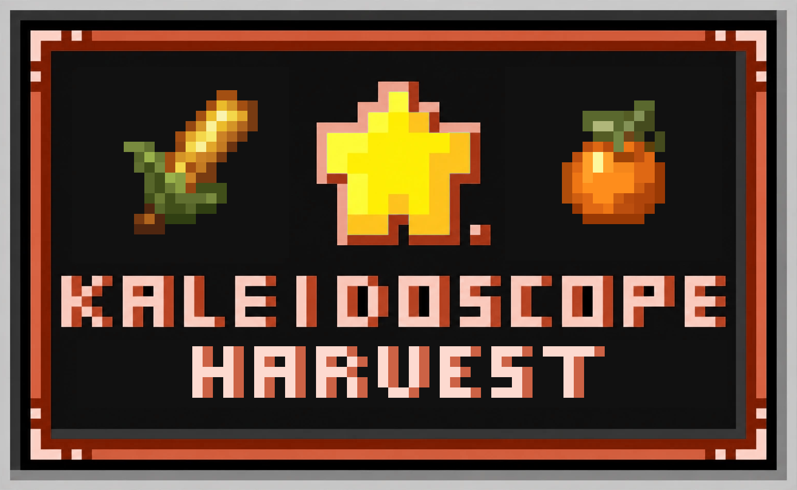

<p align="center">
  
</p>

# Kaleidoscope_Harvest_BR
《森羅物語：豐收》為《森羅物語：廚房》新增 49 種作物，包括蔬菜、香料、水果、果樹和水生作物。從田間種植、果園採收，到砧板、石磨、炒鍋上的料理，讓餐桌更加豐盛。

目前版本 1.3.1（[1.3 說明](docs/1.3_說明.md)、[1.2 說明](docs/1.2_說明.md)、[1.1 說明](docs/1.1_說明.md)）。選用聯動：《森羅物語：樂牧》（飼料、青貯）、《森羅物語：草本》（寒熱與佐使）、《森羅物語：漁歌》（魚餌與魚池飼料）、《森羅物語：酒館》（果酒、葡萄互通）；沒裝也能完整遊玩。其他附加包可以透過[對外 API](docs/API.md) 偵測豐收並查詢作物清單。

## 文件

- [企劃書](docs/PROPOSAL.zh-TW.md)（1.0）
- [1.1 企劃書](docs/PROPOSAL_1.1.zh-TW.md)：水生作物、14 種新作物、更多可放置食物
- [M1 說明：基礎與生長系統](docs/M1_說明.md)
- [M2 說明：蔬菜與香料](docs/M2_說明.md)
- [M3 說明：水果與果樹](docs/M3_說明.md)
- [M4 說明：料理與新器具](docs/M4_說明.md)
- [M5 說明：聯動與發佈](docs/M5_說明.md)（[平衡表](docs/M5_平衡表.md)）
- [1.1 說明](docs/1.1_說明.md)（[1.1 實機待測](docs/實機測試_1.1_待你測.md)）
- [對外 API](docs/API.md)：握手與作物清單；豐收和姊妹包之間送了什麼

## 開發

需要 Node 22，不需安裝套件。

```
npm run generate   # 由 packs/BP/scripts/data/ 產生方塊、物品、語言檔與貼圖清單
npm run validate   # 檢查資料與產生的檔案
npm test           # 行為測試
npm run balance    # 食物與飲品的平衡表
npm run build      # 打包成 dist/*.mcaddon（只用 Node，不需要 zip 或 Python）
```
