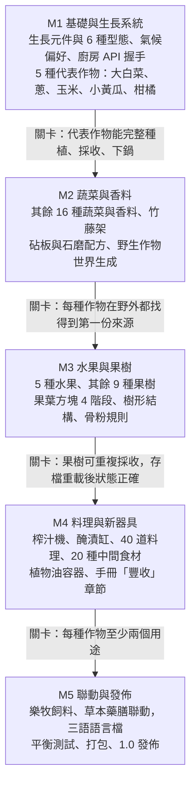

# 森羅物語：豐收 企劃書

2026-11-17

## 企劃概要

《森羅物語：豐收》（Kaleidoscope Harvest）是基岩版附加包，首版新增 35 種作物：12 種蔬菜、8 種香料、5 種水果、10 種果樹。它以《森羅物語：廚房》v1.6.6 為宿主，透過廚房公開的 Script Event 擴充 API 註冊食譜與手冊，不修改廚房本體，做法與《草本》《樂牧》一致。

| 項目 | 內容 |
| --- | --- |
| 平台 | Minecraft 基岩版 1.26.1 以上 |
| 必要前置 | 森羅物語：廚房 v1.6.6（行為包 UUID 9944f731-cc4c-4299-bdd5-f8799c1d832e） |
| 選用聯動 | 森羅物語：草本、森羅物語：樂牧 |
| 命名空間 | kaleidoscope_harvest |
| 語言 | 繁中、簡中、英文 |

設計原則：

- **不重複**：不新增廚房、草本、樂牧或原版已有的作物。
- **每種作物至少兩個用途**：一道料理加一個加工品或飼料，避免種了沒處用。
- **沉浸式**：不跳提示文字。成熟度看模型與顏色，採收靠音效與粒子回饋，延續樂牧的做法。
- **只走公開介面**：配方、手冊、刀具、油品都走廚房 API 與標籤，不引用廚房 scripts 內部檔案。

## 現有作物盤點與缺口

廚房 v1.6.6 只有 5 種作物（番茄、辣椒、生菜、稻米、茶樹），中菜最基本的蔥薑蒜、葉菜、豆類與果樹全部缺席。以下依各包的 BP 檔案盤點（廚房 v1.6.6、草本重製版 v1.2、樂牧 1.1）。

| 來源 | 已有作物 |
| --- | --- |
| 原版 | 小麥、胡蘿蔔、馬鈴薯、甜菜根、南瓜、西瓜、甜漿果、螢光漿果、可可豆、蘋果、甘蔗、竹子、海帶 |
| 廚房 | 番茄、辣椒（紅／青）、生菜、稻米與野生稻、茶樹 |
| 草本 | 當歸、菊花、人參、枸杞、金銀花、紅棗、甘草、艾草、靈芝、冬蟲夏草、茯苓 |
| 樂牧 | 苜蓿 |

缺口（豐收要補的部分）：

- **辛香料**：蔥、薑、蒜、花椒、八角都沒有，廚房的炒菜與滷味只能用辣椒與糖替代。
- **葉菜與根莖**：只有生菜一種葉菜；「羊肉蘿蔔湯」等菜名已有，實際上沒有蘿蔔作物。
- **豆類與油料**：沒有大豆、花生、芝麻，廚房已開放油品容器 API，但沒有任何植物油作物可接。
- **果樹**：原版只有橡樹掉蘋果，沒有可持續採收的果樹。

## 新增內容清單

1.0 共 35 種作物，分四類；種植方式與取得方式決定了它們在世界中怎麼出現。種子或樹苗的第一份來源都是野外，之後才能自己繁殖。

### 蔬菜（12 種）

| 作物 | 種植方式 | 第一份來源 | 主要用途 |
| --- | --- | --- | --- |
| 大白菜 | 一次性 | 平原、森林野生 | 白菜燉肉、醃白菜 |
| 青江菜 | 一次性 | 平原野生 | 蒜炒青菜、湯麵配菜 |
| 菠菜 | 一次性 | 森林野生 | 涼拌菠菜、餃子餡 |
| 洋蔥 | 一次性 | 村莊箱子 | 洋蔥炒蛋、羅宋湯替代食材 |
| 白蘿蔔 | 一次性 | 平原野生 | 蘿蔔燉牛腩、醃蘿蔔 |
| 茄子 | 可重複採收 | 熱帶草原野生 | 魚香茄子、紅燒茄子 |
| 小黃瓜 | 藤架 | 叢林野生 | 拍黃瓜、醃黃瓜 |
| 玉米 | 兩格高 | 平原野生 | 蒸玉米、玉米濃湯、樂牧飼料 |
| 大豆 | 一次性 | 平原野生 | 豆腐、豆漿、醬油、樂牧飼料 |
| 花生 | 一次性（地下） | 熱帶草原野生 | 花生油、花生醬、宮保料理 |
| 地瓜 | 一次性（地下） | 村莊箱子 | 烤地瓜、地瓜粥 |
| 芋頭 | 一次性 | 沼澤野生 | 芋頭蒸排骨、芋泥 |

### 香料（8 種）

| 作物 | 種植方式 | 第一份來源 | 主要用途 |
| --- | --- | --- | --- |
| 蔥 | 可重複採收 | 平原野生 | 蔥花、蔥油餅、幾乎所有炒菜 |
| 大蒜 | 一次性（地下） | 平原野生 | 蒜末、蒜泥白肉 |
| 薑 | 一次性（地下） | 叢林野生 | 薑絲、薑母茶 |
| 香菜 | 一次性 | 森林野生 | 湯品與麵食點綴 |
| 芝麻 | 一次性 | 熱帶草原野生 | 芝麻油、芝麻粉、湯圓餡 |
| 花椒 | 灌木，可重複採收 | 繁茂山丘野生 | 麻辣料理、花椒油 |
| 黑胡椒 | 藤架，可重複採收 | 叢林野生 | 黑胡椒牛排、胡椒餅 |
| 孜然 | 一次性 | 沙漠邊緣野生 | 孜然羊肉串 |

### 水果（5 種）

| 作物 | 種植方式 | 第一份來源 | 主要用途 |
| --- | --- | --- | --- |
| 草莓 | 可重複採收 | 繁花森林野生 | 草莓大福、果醬 |
| 藍莓 | 灌木，可重複採收 | 針葉林野生 | 藍莓派、果醬 |
| 葡萄 | 藤架，可重複採收 | 村莊箱子 | 葡萄汁、葡萄乾、葡萄酒（酒館聯動預留） |
| 百香果 | 藤架，可重複採收 | 叢林野生 | 百香果茶、果汁 |
| 鳳梨 | 一次性，原株再生 | 熱帶草原野生 | 鳳梨酥、鳳梨炒飯 |

### 果樹（10 種）

| 果樹 | 適合氣候 | 第一份來源 | 主要用途 |
| --- | --- | --- | --- |
| 柑橘 | 溫暖 | 村莊樹苗 | 橘子汁、陳皮 |
| 檸檬 | 溫暖 | 熱帶草原野生 | 檸檬茶、檸檬雞 |
| 桃 | 溫和 | 繁花森林野生 | 桃子、蜜桃凍 |
| 梨 | 溫和 | 森林野生 | 冰糖燉梨 |
| 柿子 | 溫和偏涼 | 針葉林邊緣野生 | 柿餅 |
| 荔枝 | 炎熱 | 叢林野生 | 荔枝、荔枝肉 |
| 芒果 | 炎熱 | 叢林野生 | 芒果冰、芒果糯米飯 |
| 香蕉 | 炎熱 | 叢林野生 | 香蕉、拔絲香蕉 |
| 八角樹 | 溫暖 | 繁茂山丘野生 | 八角（滷味、紅燒必備） |
| 肉桂樹 | 溫暖 | 叢林邊緣野生 | 肉桂皮、五香粉 |

八角與肉桂歸在果樹，因為它們是長成大樹後摘果或剝皮，生長邏輯與果樹相同。

## 種植與生長系統

所有作物分成六種生長型態，共用同一套生長元件；參數沿用廚房 `crop_growth` 的欄位（`growth_chance`、`min_light_level`、`max_growth`、`harvest_reset_age`），讓玩家感受與廚房作物一致。

| 型態 | 適用作物 | 運作方式 |
| --- | --- | --- |
| 一次性 | 大白菜、菠菜、大豆等 | 8 階段生長，收成後掉落產物與種子，方塊消失 |
| 地下作物 | 花生、地瓜、大蒜、薑 | 地上只見葉子，成熟時葉片轉黃；用鋤頭挖出時產量較高 |
| 可重複採收 | 茄子、蔥、草莓 | 右鍵採收，回到 `harvest_reset_age` 階段繼續長 |
| 兩格高 | 玉米 | 下半格長莖，後半生長期長出上半格；打掉任一格兩格一起掉落 |
| 藤架 | 小黃瓜、黑胡椒、葡萄、百香果 | 要先搭【竹藤架】方塊；藤蔓長滿架子後結果，可重複採收 |
| 灌木與果樹 | 花椒、藍莓、10 種果樹 | 樹苗種在泛土或草地，長成後每輪開花、結果、採收，不會死亡 |

**氣候偏好**：基岩版沒有季節，改用生物群系溫度做區分。每種作物標記「寒冷／溫和／溫暖／炎熱」偏好：種在偏好氣候內生長速度 ×1；相鄰一級 ×0.5；差兩級以上不生長。這讓玩家有理由在不同地區開分場，也為溫室留下空間（見開放問題）。

**果樹生長**：果樹不用原版樹木，而是一個樹苗錨點方塊加上結構生成的果葉方塊。果葉方塊帶 `fruit_stage` 狀態（無果→開花→青果→熟果），採收後回到無果，不用重種。樹幹可用斧頭砍倒取得果木木材，但會失去果樹。

**沉浸式回饋**（不跳任何提示文字）：

- 成熟度只看模型：果實從青轉色、葉片變黃、玉米穗鬚變深。
- 熟果會偶爾飄出小粒子，採收時有專屬音效；種在不對的氣候時葉片偏灰。
- 骨粉對果樹只推進一階段，且會有綠色粒子，避免一鍵成林。

## 加工與料理整合

豐收的作物主要在廚房既有的 8 種器具上加工，只新增 2 種廚房沒有的器具：榨汁機與醃漬缸。全部配方透過 `kaleidoscope_cookery:register_recipe` 註冊，註冊前先檢查 `api_ready` 回傳的 `capabilities`。

| 器具 | API kind | 豐收的用法 | 範例 |
| --- | --- | --- | --- |
| 砧板 | chopping_board | 切配料 | 蔥→蔥花、大蒜→蒜末、薑→薑絲、肉桂→肉桂皮 |
| 石磨 | millstone | 磨粉與榨油 | 芝麻→芝麻粉＋芝麻油、花生→花生油、花椒＋八角＋肉桂→五香粉、大豆→豆漿 |
| 炒鍋 | wok | 炒菜 | 魚香茄子、蒜炒青菜、宮保雞丁、鳳梨炒飯 |
| 湯鍋 | stockpot_exact／flex | 燉煮 | 白菜燉肉、蘿蔔燉牛腩、玉米濃湯、冰糖燉梨 |
| 蒸籠 | steamer | 蒸食 | 蒸玉米、芋頭蒸排骨、蒸地瓜 |
| 竹篩 | bamboo_tray | 曬乾 | 柿子→柿餅、葡萄→葡萄乾、橘皮→陳皮 |
| 茶壺 | teapot | 果茶與香料茶 | 檸檬茶、百香果茶、薑母茶 |
| 油品容器 | oil_containers | 植物油裝瓶 | 花生油、芝麻油、花椒油可直接當廚房的炒鍋用油 |
| **榨汁機（新）** | 豐收自有 | 水果→果汁 | 橘子汁、葡萄汁、芒果汁；可混兩種水果 |
| **醃漬缸（新）** | 豐收自有 | 時間發酵 | 泡菜、醃蘿蔔、醃黃瓜、醬油（大豆）、果醬 |

**料理數量**：1.0 預計 40 道料理與 20 種中間食材（蔥花、蒜末、豆腐、醬油等）。每道料理都有手冊頁，經廚房 Guidebook Extension API 寫入「豐收」章節。

**重用廚房既有菜名**：廚房的「羊肉蘿蔔湯」等菜在內建配方先行的規則下不能覆寫，豐收改用 `stockpot_flex` 註冊另一組「白蘿蔔版」配方，讓玩家多一種做法。

**選用聯動**：

- **樂牧**：玉米、大豆、豆渣可送進飼料混合機做濃縮飼料（需確認樂牧 API 是否開放飼料配方註冊）。
- **草本**：薑、陳皮、八角、肉桂可作為藥膳輔料，走草本的握手 SDK。
- 未安裝聯動包時，相關用途不出現，豐收本身仍完整可玩。

## 美術與技術規格

豐收是一組 BP＋RP，腳本走 Script API，對廚房只用公開事件與標籤，結構比照樂牧的 `packs/BP`、`packs/RP` 配置。

### 與廚房的接點

| 接點 | 做法 |
| --- | --- |
| manifest 相依 | dependencies 加入廚房 BP UUID 9944f731-cc4c-4299-bdd5-f8799c1d832e，min_engine_version 1.26.1 |
| 配方註冊 | 啟動後送 `api_ping`，收到 `api_ready` 後逐筆送 `register_recipe`；重複送安全 |
| 耕地 | 作物 placement_filter 接受 `minecraft:farmland` 與 `kaleidoscope_cookery:farmland` 標籤（廚房水田也能種） |
| 鐮刀收割 | 作物方塊帶 `kaleidoscope_cookery:crop` 標籤，廚房鐮刀範圍收割自動適用（需實測確認） |
| 創造模式分組 | 沿用 `itemGroup.name.crops`、`ingredients`、`foods` 等廚房分組 |
| 手冊 | Guidebook Extension API 新增「豐收」章節與頁面圖示 |
| 植物油 | 花生油、芝麻油、花椒油用 oil_containers 註冊，容量預設 256 |

### 資產清單（估算）

| 類別 | 數量 | 備註 |
| --- | --- | --- |
| 作物方塊 | 25 種，約 150 張階段貼圖 | 一般作物用廚房的 crossedcrop 幾何；玉米、藤架用 Blockbench 自製模型 |
| 果樹 | 10 種樹苗＋10 種果葉方塊＋10 組樹形結構 | 每種果葉 4 階段；樹形用 structure 檔 |
| 新器具 | 3 個方塊（竹藤架、榨汁機、醃漬缸） | Blockbench 模型，醃漬缸缸內內容物分 3 階段變色 |
| 物品圖示 | 約 140 個 | 種子、產物、中間食材、料理 |
| 世界生成 | 約 30 組 feature ＋ feature_rule | 比照廚房 wild_crops 的野生稻寫法 |
| 音效與粒子 | 採收音、熟果粒子、醃漬完成音 | 非文字回饋的主要載體 |
| 語言檔 | zh_TW、zh_CN、en_US | 手冊內容一併翻譯 |

貼圖以 16×16 為主，符合廚房與草本的畫風；若跟草本一樣提供 PBR texture set，要加入 PBR 檢查工具。

## 開發時程與風險

開發分 5 個里程碑，M1 先用 5 種代表作物打通全部生長型態與廚房接點，之後的里程碑只是填內容。各階段工期待定。

每個關卡沒過就不進下一階段；G4 沒過的作物延到 1.1，不硬塞進 1.0。

### 風險

| 風險 | 影響 | 對策 |
| --- | --- | --- |
| 廚房更新改動內部結構 | 配方註冊失敗 | 只用 v1 公開事件；啟動時檢查 capabilities，缺少就跳過該類配方 |
| 廚房鐮刀不認新作物 | 玩家只能逐格採收 | M1 實測；不行就豐收自寫範圍收割事件 |
| 果樹方塊多造成效能負擔 | 大果園掉幀 | 果葉靠 random tick 生長，不做每 tick 掃描；限制單棵樹的果葉數 |
| 作物太多稀釋重點 | 玩家不知道怎麼用 | 關卡 G4，加上手冊每種作物都列出用途 |
| 與其他附加包撞名 | 物品被覆蓋 | 全部用 kaleidoscope_harvest 命名空間 |

### 開放問題

- [ ] 是否做溫室（玻璃罩內忽略氣候偏好）？放 1.0 還是 1.1？
- [ ] 樂牧是否開放飼料配方的註冊 API？
- [ ] 葡萄酒由豐收做，還是留給酒館（Tavern）聯動？
- [ ] 是否比照草本提供 PBR texture set？
- [ ] 1.0 目標發佈日期與各里程碑工期。
