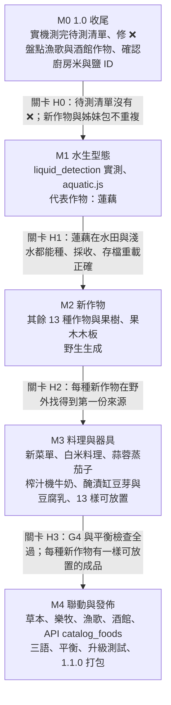

# 森羅物語：豐收 1.1 企劃書

2026-11-18

> 1.0 的企劃見 [企劃書](PROPOSAL.zh-TW.md)。本文件只寫 1.1 改了什麼、加了什麼；1.0 的設計原則、生長系統與廚房接點照舊，不重抄。

## 企劃概要

1.0 讓中菜的基本作物上了田，1.1 要讓它們**上桌**，並把版圖往**水邊**和**南方**推。內容分三塊：

1. **收進已完成的 1.0 之後的工作**：可放置的飲品與食物、器具動畫、PBR、對外 API 與漁歌握手。這些已在主幹上，還沒發佈。
2. **補 1.0 留下的缺口**：白米料理、蒜蓉蒸茄子、果木木板，以及實機測試還沒過的項目。
3. **新內容**：14 種作物（含新的「水生」生長型態）、約 35 樣料理／飲品／中間食材、榨汁機與醃漬缸的新做法、更多可放置食物。

| 項目 | 1.0.0 | 1.1.0 |
| --- | --- | --- |
| 作物 | 35 種（蔬菜 12、香料 7、水果 5、果樹 11） | **49 種**（＋水生 3、瓜類 2、豆類 2、香料 3、果樹 4） |
| 生長型態 | 6 種 | **7 種**（＋水生） |
| 可吃的東西 | 91 樣 | 約 130 樣 |
| 可放置食物 | 0（1.0 之後加了 21 樣，未發佈） | 34 樣 |
| 新器具 | 竹藤架、榨汁機、醃漬缸 | 不新增；榨汁機可加牛奶、醃漬缸可發豆芽 |
| 對外 API | API 1：`catalog` | API 1：`catalog` 加 `aquatic` 型態，新增 `catalog_foods` |
| 前置 | 廚房 v1.6.6、基岩版 1.26.1 | 不變 |

版本規則不變：版本號只寫在 `packs/BP/scripts/data/version.js`，兩個 manifest 的 UUID 不變、版本改成 `[1, 1, 0]`。不改任何既有 ID，1.0 的世界直接升級。

## 1.1 的設計原則

延續 1.0 的四條（不重複、每種作物至少兩個用途、沉浸式、只走公開介面），另加兩條：

- **端上桌**：每種新作物至少有一樣成品可以放在桌上吃；湯、甜點、果汁、茶照 1.0 之後的四種外形，不另發明新外形（除非實機確認舊外形不夠用）。
- **先修再加**：M0 的測試沒過，不開始做新作物。1.0 待測清單裡的 ❌ 一律先修。

## 一、1.0 之後已完成、隨 1.1 發佈

| 功能 | 狀態 | 文件 |
| --- | --- | --- |
| 21 樣可放置的飲品與食物（大鍋菜 6、甜點 3、果汁果酒 8、茶 4），借廚房的 `food_bite`、`cup_stack` | 完成，部分右鍵互動待實機測 | [設計](superpowers/specs/2026-11-17-placeable-food-design.md)、[計畫](superpowers/plans/2026-11-17-placeable-food.md) |
| 榨汁機、醃漬缸的顯示實體與動畫（液面、榨汁錐、蓋子、水封氣泡、果汁水滴） | 完成，實機確認大部分 | [設計](superpowers/specs/2026-11-17-station-animations-design.md) |
| 食物與器具模型改成森羅廚房標準（少面數、每面手繪） | 完成 | — |
| 飲品、食物圖示重畫成和放下的方塊一致 | 完成 | — |
| PBR：物品圖示、放置的食物、器具、顯示實體 | 完成 | — |
| 豐收自己的對外 API（`catalog`）、漁歌握手（魚餌、魚池飼料） | 完成 | [對外 API](API.md) |

## 二、補 1.0 的缺口

| 缺口 | 1.0 為什麼沒做 | 1.1 做法 |
| --- | --- | --- |
| 地瓜粥、滷肉飯、鳳梨炒飯、芒果糯米飯 | 不確定廚房的米 ID | M0 從廚房 v1.6.6 的公開物品與標籤確認白米、熟飯 ID；確認後照常用 `register_recipe` 註冊。廚房若沒有糯米，芒果糯米飯改成「芒果飯」或拿掉，不自己加糯米（不重複原則） |
| 蒜蓉蒸茄子 | 廚房蒸籠一次只收一樣材料 | 先在工作台把茄子＋蒜末合成中間食材「蒜蓉茄子（生）」，再進蒸籠。同一招可用在 1.1 其他需要兩樣材料的蒸菜 |
| 果木只有原木 | 1.0 範圍外 | 加果木木板（1 原木 → 4 木板），帶 `minecraft:planks` 標籤，可以做原版的木製品；台階、樓梯、門延後到之後的版本 |
| 草本佐使只登記陳皮、肉桂皮 | 刻意省名額 | 不變。1.1 的新作物也不登記佐使 |
| 樂牧 `ruminant`、`calcium` 飼料 | 要樂牧 `feed_1_1` | 樂牧有回 `feed_1_1` 才送：玉米葉（新，採收玉米時掉落）算 `ruminant`；沒有就照 1.0 |
| 酒館要求果酒可放置 | 不確定 | 果酒在 1.0 之後已可放置；裝了酒館後確認酒館裝出的是不是豐收的方塊 |

### 實機測試尚未通過的項目

[實機測試：要你親手測的](實機測試_待你測.md) 全部要在 M0 測完，特別是需要真的滑鼠右鍵的：可放置食物的吃、喝、疊茶；作物與果實的右鍵採收；廚房器具做豐收的菜、植物油、手冊；廚房鐮刀與水田；樂牧飼槽、草本寒熱與砂鍋、酒館酒桶；三語切換；0.1.0 → 1.0 升級；大片果園的效能。

另外補：

- 1.0.0 → 1.1.0 升級：舊世界的作物、果樹、榨汁機與醃漬缸內容物都還在，顯示實體會自己補上。

## 三、新增作物（14 種）

挑選標準和 1.0 一樣：原版、廚房、草本、樂牧沒有；中菜或台灣、華南常見；每種至少兩道菜。**漁歌與酒館的作物清單 M0 要再盤點一次**（1.0 盤點時沒有這兩包），撞到的就換掉。

### 水生（3 種，新型態）

| 作物 | 種植方式 | 第一份來源 | 主要用途 |
| --- | --- | --- | --- |
| 蓮藕 | 水生，一次性；也結蓮蓬 | 沼澤野生 | 蓮藕排骨湯、炒藕片；蓮蓬剝出蓮子 |
| 茭白筍 | 水生，可重複採收 | 河岸野生 | 茭白筍炒肉絲、烤茭白筍 |
| 空心菜 | 水生，可重複採收 | 沼澤、紅樹林野生 | 蒜炒空心菜、腐乳空心菜 |

### 瓜類（2 種，藤架）

| 作物 | 種植方式 | 第一份來源 | 主要用途 |
| --- | --- | --- | --- |
| 苦瓜 | 藤架，可重複採收 | 叢林野生 | 苦瓜炒蛋、涼拌苦瓜 |
| 絲瓜 | 藤架，可重複採收 | 村莊箱子 | 絲瓜炒蛋、絲瓜湯 |

### 豆類（2 種）

| 作物 | 種植方式 | 第一份來源 | 主要用途 |
| --- | --- | --- | --- |
| 紅豆 | 一次性 | 平原野生 | 紅豆湯、紅豆餡 → 紅豆餅 |
| 綠豆 | 一次性 | 熱帶草原野生 | 綠豆湯、綠豆糕；醃漬缸發成綠豆芽 |

### 香料（3 種）

| 作物 | 種植方式 | 第一份來源 | 主要用途 |
| --- | --- | --- | --- |
| 韭菜 | 可重複採收 | 平原野生 | 韭菜盒子、韭菜炒蛋 |
| 香茅 | 可重複採收 | 叢林邊緣野生 | 香茅茶、香茅烤雞 |
| 花椒 | 灌木，可重複採收 | 繁茂山丘、竹林野生 | 花椒粉 → 麻婆豆腐、椒麻雞 |

花椒是小灌木，和藍莓一樣走灌木型態，不做成大樹。

### 果樹（4 種）

| 果樹 | 適合氣候 | 第一份來源 | 主要用途 |
| --- | --- | --- | --- |
| 龍眼 | 炎熱 | 叢林野生 | 曬成桂圓 → 桂圓茶；龍眼酒 |
| 枇杷 | 溫暖 | 繁花森林野生 | 枇杷膏、枇杷汁 |
| 楊桃 | 炎熱 | 叢林邊緣野生 | 楊桃汁、蜜餞楊桃 |
| 木瓜 | 炎熱 | 熱帶草原野生 | 木瓜牛奶、涼拌青木瓜 |

木瓜是單幹、果實貼著樹幹長，樹形用 `tree_feature` 做成細高樹幹加頂端一叢葉，果實掛在葉叢下方，邏輯和 1.0 的垂掛果實相同。

## 四、水生型態

| 項目 | 規則 |
| --- | --- |
| 種在哪 | 廚房的水田（`kaleidoscope_cookery:farmland` 標籤的水田）優先；另外接受「一格深的水，底下是泥土、泥巴或黏土」 |
| 方塊與水 | 作物方塊用 `minecraft:liquid_detection` 讓它可以泡在水裡；M1 第一件事就實測。不行的話只能種在廚房水田上，企劃照樣成立 |
| 生長 | 8 階段，參數沿用 `crop_growth`；水乾掉（水源被拿走）時停止生長、葉子偏灰，和種錯氣候同一種回饋 |
| 採收 | 蓮藕一次性：挖出蓮藕，偶爾掉蓮蓬；茭白筍、空心菜右鍵採收回到 `harvest_reset_age` |
| 溫室 | 照 1.0：玻璃罩內忽略氣候 |
| 野生 | `swamp`、`mangrove_swamp`、`river` 標籤的淺水邊 |

沉浸式回饋：成熟的蓮藕方塊頂端冒出粉色荷花；茭白筍成熟時莖基部變胖；空心菜葉片轉深綠。採收時播水花音效與水花粒子。

## 五、料理與加工

所有配方照 1.0 的做法寫在 `data/menu.js`，一列一樣東西；G4（每種作物至少兩個用途）與平衡檢查照樣由 `npm run validate` 擋。

### 新增料理與飲品

| 器具 | 新做法 |
| --- | --- |
| 砧板 | 藕片、青木瓜絲 |
| 石磨 | 紅豆餡、綠豆粉、花椒粉 |
| 炒鍋 | 炒藕片、茭白筍炒肉絲、蒜炒空心菜、腐乳空心菜、苦瓜炒蛋、絲瓜炒蛋、炒豆芽、韭菜炒蛋、香茅烤雞、麻婆豆腐、椒麻雞；白米：鳳梨炒飯 |
| 湯鍋 | 蓮藕排骨湯、絲瓜湯、紅豆湯、綠豆湯、枇杷膏；白米：地瓜粥、滷肉飯 |
| 蒸籠 | 綠豆糕、蒜蓉蒸茄子；白米：芒果糯米飯（見缺口） |
| 茶壺 | 香茅茶、桂圓茶 |
| 竹篩 | 龍眼 → 桂圓、蓮蓬 → 蓮子 |
| 工作台 | 紅豆餅、韭菜盒子、蒜蓉茄子（生）、果木木板、涼拌苦瓜、涼拌青木瓜 |
| 熔爐 | 烤茭白筍 |
| 榨汁機 | 枇杷汁、楊桃汁；**新**：木瓜牛奶、香蕉牛奶 |
| 醃漬缸 | 蜜餞楊桃、龍眼酒；**新**：豆腐乳、綠豆芽 |

估計 30 樣料理與飲品、10 樣中間食材（藕片、青木瓜絲、紅豆餡、綠豆粉、花椒粉、桂圓、蓮子、豆腐乳、綠豆芽，加上蒜蓉茄子（生）），數字以 M3 結束時 `npm run balance` 為準。

### 器具的新功能（不新增器具）

- **榨汁機加牛奶**：第二格可以放牛奶桶，搭配木瓜或香蕉榨出「〇〇牛奶」，倒完還回空桶。液面顏色是水果色混白。綜合果汁的規則不變（兩樣不同水果）。
- **醃漬缸發豆芽**：綠豆＋水瓶封缸半天，開缸得綠豆芽；這是醃漬缸第一個「不用鹽糖」的配方，蓋子動畫照舊。
- **豆腐乳**：豆腐＋鹽（或廚房的調味料，M0 確認 ID）封缸 3 天，和醬油同一級時間。

### 可放置（新增 13 樣）

| 外形 | 新增 |
| --- | --- |
| 大鍋菜（4 口） | 蓮藕排骨湯、絲瓜湯、紅豆湯、綠豆湯、麻婆豆腐 |
| 甜點（4 口） | 紅豆餅、綠豆糕 |
| 瓶（1 口） | 枇杷汁、楊桃汁、木瓜牛奶、龍眼酒 |
| 茶（疊 4 杯） | 香茅茶、桂圓茶 |

規則和 1.0 之後的 21 樣相同（`food_bite`、`cup_stack`、面向玩家、打掉沒動過的掉回整份）。白米料理是碗裝飯，現有外形沒有「碗」，1.1 先不做成可放置。

## 六、聯動

做法照 1.0：只送 Script Event、先等 `api_ready` 看 `capabilities`、對方沒裝就什麼都不送。新增的資料一樣寫在 `data/integrations.js`，每列附理由。

| 附加包 | 1.1 新增 |
| --- | --- |
| 草本（寒熱） | 綠豆湯 −25、苦瓜 −20、涼拌苦瓜 −15、蓮藕排骨湯 −5、枇杷膏 −10、楊桃汁 −10、紅豆湯 +5、桂圓茶 +20、龍眼酒 +20、香茅茶 +10、麻婆豆腐 +20、椒麻雞 +15。仍壓在 ±30 以內 |
| 草本（佐使） | 不新增 |
| 樂牧（飼料） | 紅豆、綠豆 grain 1；空心菜 veg 1；玉米葉 grass 1（有 `feed_1_1` 時改 `ruminant`） |
| 漁歌（魚餌、魚池飼料） | 綠豆魚餌 0.7；紅豆餡魚池飼料 1 餐 |
| 酒館 | 龍眼酒用酒館 SDK 登記成酒桶配方（龍眼＋糖＋小麥，和荔枝酒同規格）；醃漬缸的龍眼酒保留 |

### 對外 API（仍是 API 1，只增加）

- `catalog` 的 `crops.form` 多一種 `aquatic`。API 文件加一句「看不懂的 `form` 請當成 `once`」，舊的姊妹包不會壞。
- 新 capability `catalog_foods`：`catalog_request` 的 `kind: "foods"` 回傳豐收所有可吃的東西 `{id, hunger, saturation, placeable, container?}`，讓樂牧、漁歌之類的包不用猜哪些是食物。
- `api_ready.version` 改成 `1.1.0`。

## 七、美術與技術規格

### 資產清單（估算）

| 類別 | 數量 | 備註 |
| --- | --- | --- |
| 作物方塊 | 10 種，約 70 張階段貼圖 | 水生 3 種要自製模型（泡水時的水面以下部分）；苦瓜、絲瓜沿用竹藤架的 `bamboo_trellis_<id>` 模型；花椒沿用藍莓的灌木 |
| 果樹 | 4 種樹苗、4 種果葉、4 種垂掛果實、4 組 `tree_feature` | 木瓜是新樹形（細高單幹） |
| 果木木板 | 1 個方塊 | |
| 可放置食物 | 13 樣 | 沿用現有 4 種外形，只換貼圖與內容物 |
| 器具 | 榨汁機牛奶液面、醃漬缸豆芽內容物 | 改顯示實體的顏色表與貼圖 |
| 物品圖示 | 約 60 個 | 照 1.0 之後的做法：飲品、食物的圖示和放下的方塊一致 |
| PBR | 上面全部 | 照 `tools/art/pbr_maps.py` |
| 世界生成 | 約 16 組 feature＋feature_rule | 水生的放置規則要新寫 |
| 語言檔、手冊 | 三語 | 手冊「豐收」章節加「水生」分類 |

美術流程不變：`tools/art/` 產生、`npm run generate` 寫進包裡、`docs/art/MISSING_ART.md` 列出還沒畫的。

### 程式

| 檔案 | 改動 |
| --- | --- |
| `growth/` | 新增 `aquatic.js`：水源檢查、泡水判斷；其他型態沿用 |
| `data/crops.js`、`data/trees.js`、`data/climate.js` | 新作物、新果樹、氣候 |
| `data/menu.js`、`data/placedFood.js` | 新菜單與可放置食物 |
| `stations/juicer.js`、`stations/picklingJar.js` | 牛奶、豆芽、豆腐乳 |
| `api/harvestApi.js` | `aquatic`、`catalog_foods` |
| `data/integrations.js`、`data/tavern.js` | 新的聯動資料 |
| `tools/validate.mjs` | 水生作物必須有水源或水田規則；可放置食物必須有對應外形；新 capability 的回覆長度 |
| `tools/test/` | 新的行為測試（見各里程碑關卡） |

## 八、開發時程與風險

和 1.0 一樣不訂日期，前一個關卡通過才進下一個。

H3 沒過的作物延到下一版，不硬塞進 1.1。M0 盤點後撞名的作物直接從清單拿掉，不找替代品湊數。

### 測試

- `npm test` 目前 81 項。每個里程碑加自己的行為測試：水生的水源判斷與停止生長、榨汁機牛奶與空桶、醃漬缸豆芽、`catalog_foods` 分封不超過 2048 字元、新聯動的 capability 檢查。
- 每個里程碑結束出一份「實機測試」文件，格式照第 1、2 輪；最後更新[測試表](測試表.md)為 1.1.0 版。

### 風險

| 風險 | 影響 | 對策 |
| --- | --- | --- |
| 自訂方塊泡水不可行或有怪現象（水流沖掉、方塊外觀錯） | 水生型態做不出來 | M1 第一件事就測；不行就只種在廚房水田，企劃不用改 |
| 廚房改版動到 `food_bite`、`cup_stack` | 可放置食物失效 | 1.1 仍鎖廚房 v1.6.6；廚房改版時先跑可放置食物的實機測試再跟版 |
| 廚房沒有開放米、鹽的 ID 或標籤 | 白米料理、豆腐乳做不出來 | 不自己加米和鹽；做不出來的菜從清單拿掉 |
| 新作物和漁歌、酒館撞名 | 違反不重複原則 | M0 盤點，撞到就拿掉 |
| 49 種作物讓手冊太長 | 玩家找不到 | 手冊「豐收」章節依型態分頁，新增「水生」分類 |
| 果園與水田一大片時效能 | 掉幀 | 1.0 沒測到的效能測試在 M0 做；水生的水源檢查只在 random tick 做 |
| 草本寒熱名額、佐使名額被別包佔滿 | 註冊被拒 | 只登記寒熱，佐使不新增；被拒只寫內容記錄 |

### 已定決策（本企劃的預設，要改請直接改這張表）

| 問題 | 決策 |
| --- | --- |
| 1.0 之後的功能何時發佈 | 隨 1.1.0 一起發佈，不另出 1.0.x |
| 新作物數量 | 14 種；寧可少不硬湊 |
| 新器具 | 不新增，擴充榨汁機與醃漬缸 |
| 水生作物種在哪 | 廚房水田優先，另接受淺水 |
| 白米料理 | 用廚房的米（`rice`、`cooked_rice`）；廚房沒有糯米，芒果糯米飯拿掉 |
| 豆腐乳 | 廚房沒有鹽：改成豆腐 ×2＋醬油 |
| 綠豆芽 | 綠豆 ×2 封缸半天，不用水瓶（水瓶在腳本裡分不出是不是水） |
| 椒麻雞 | 廚房已有麻辣雞，改名「花椒雞丁」 |
| 花椒野外 | 竹林是炎熱氣候，花椒是溫和作物，改成草甸、樺木森林 |
| 果木 | 只加木板；台階、樓梯、門之後再說 |
| API | 仍是 API 1，只加 `aquatic` 與 `catalog_foods` |
| Biomes O' Plenty | 取消相容，只支援原版生物群系 |
| 前置版本 | 廚房 v1.6.6、基岩版 1.26.1 不變 |
| 時程 | 不訂日期，關卡通過就進下一步 |
